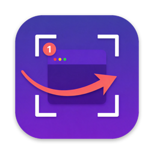
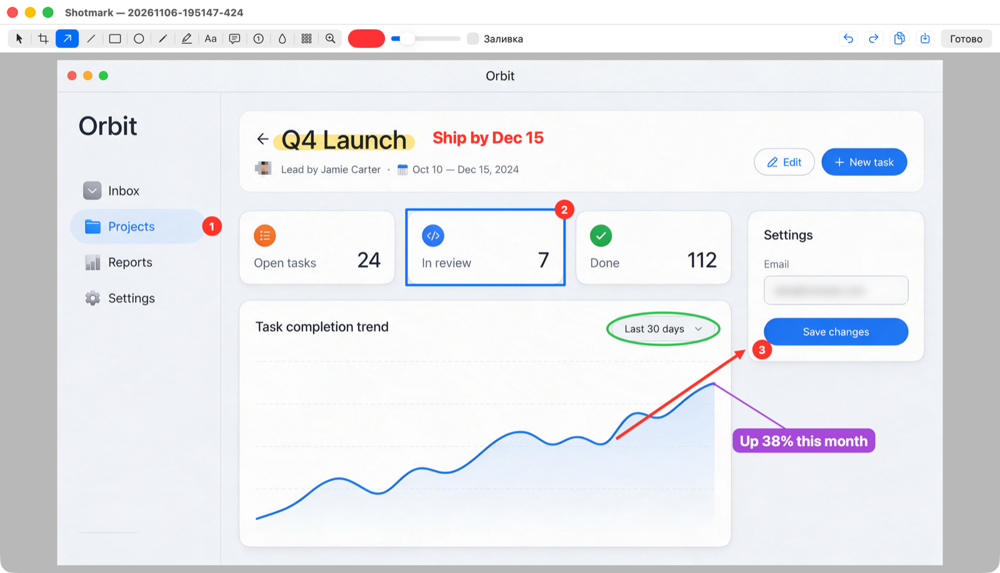
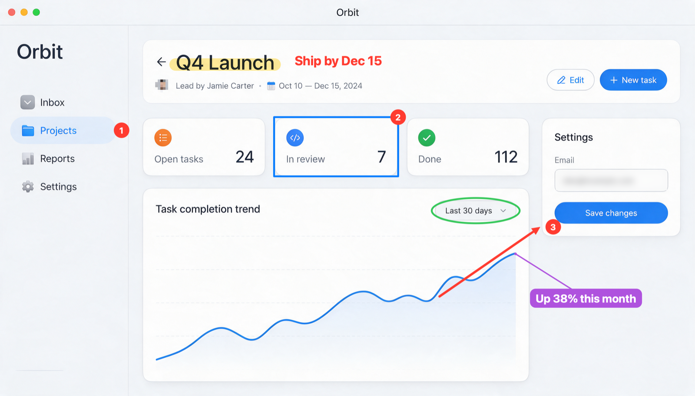

<p align="center">
  
</p>

<h1 align="center">Shotmark</h1>

<p align="center">
  ShareX-style screenshots and markup for macOS, with an MCP server so AI agents can use every feature.
  <br>
  <a href="README.ru.md">Русская версия</a>
</p>

<p align="center">
  
</p>

## What it does

- Replaces ⌘⇧3, ⌘⇧4 and ⌘⇧5. Full screen, region, window and screen recording.
- Annotate at the moment of capture. ⌘⇧4 freezes the screen and turns it into a canvas. Draw arrows, steps or text on it, then drag the region you want. The shot is taken when you release the mouse, like ShareX.
- The full ShareX toolset. Arrows, lines, rectangles, ellipses, freehand pen, highlighter, text, callouts, numbered steps, blur, pixelate, magnifier, crop, undo and redo, color and stroke width.
- Edit what you drew. The select tool moves shapes and resizes them by their handles. Right-click a shape to change its color, width, size, blur strength or text.
- Nested captures. Press ⌘⇧4 inside a capture to screenshot the capture itself. Finish the top level and you are back on the one below.
- Every shot is saved. Your captures go to the clipboard and to `~/Pictures/Screenshots/YYYY-MM/`.
- MCP server for agents. 18 tools: capture the screen, a region, a window or an app, list windows, add any annotation, export, browse the history, and read a capture back as an image. Agents work in the background, so you never see a window pop up because of them.

<p align="center">
  
</p>

## Install

Requires macOS 15 or newer and the Swift toolchain (`xcode-select --install`). Xcode itself is not needed.

```bash
curl -fsSL https://raw.githubusercontent.com/IliaOknesavi/shotmark/main/scripts/install.sh | bash
```

The script clones the repository to `~/shotmark`, builds the app, signs it with a local certificate, installs it to `~/Applications/Shotmark.app` and starts it. If the Claude Code CLI is installed, it also connects the MCP server for every project. Run it again later to update.

Then, once:

1. System Settings → Privacy & Security → Screen & System Audio Recording: turn on Shotmark, then quit it from its menu and open it again.
2. When Shotmark asks, let it take over ⌘⇧3 / ⌘⇧4 / ⌘⇧5 from the built-in screenshots. The same menu can give them back.

Shotmark starts at login and lives in the menu bar. If the menu bar is too crowded to show its icon, open Shotmark again from Spotlight and its menu appears at the cursor.

### Installing with an AI agent

Send your agent a link to this repository and ask it to install Shotmark. The steps for the agent:

1. Run `scripts/install.sh` from a clone, or the `curl` line above.
2. Ask the user to grant Screen Recording (step 1 above). The agent cannot do this itself.
3. Check the connection: call the `history` tool, or `capture_screen` once permission is granted.

## Shortcuts

| Keys | Action |
|---|---|
| ⌘⇧3 | Capture the screen under the cursor |
| ⌘⇧4 | Freeze the screen: draw on it, then drag a region and release to capture. Click a window to capture it. Right-click while dragging to cancel the region; right-click on empty space or Esc to leave. ⌘E opens the shot in the editor |
| ⌘⇧5 | Record a region or a window to MP4 (`~/Movies/Shotmark`); press again to stop |

Tool keys: select V, region C, arrow A, line L, rectangle R, ellipse E, pen P, highlighter M, text T, callout O, step N, blur B, pixelate X, magnifier Z. Hold Shift for straight angles and squares. Delete removes the selected shape, and a double-click edits text.

## Connecting an agent (MCP)

The server runs inside the app at `http://127.0.0.1:47830/mcp` (Streamable HTTP). It only listens on localhost, needs a bearer token and rejects requests coming from web pages. The token is in `~/Library/Application Support/Shotmark/token`, and the menu item "Скопировать команду подключения MCP" copies a ready command.

Claude Code, for all projects and chats:

```bash
claude mcp add --scope user --transport http shotmark http://127.0.0.1:47830/mcp \
  --header "Authorization: Bearer $(cat ~/Library/Application\ Support/Shotmark/token)"
```

Codex:

```bash
echo 'export SHOTMARK_TOKEN="$(cat ~/Library/Application\ Support/Shotmark/token)"' >> ~/.zshenv
codex mcp add shotmark --url http://127.0.0.1:47830/mcp --bearer-token-env-var SHOTMARK_TOKEN
```

Other clients that support Streamable HTTP with headers, such as Cursor:

```json
{
  "mcpServers": {
    "shotmark": {
      "url": "http://127.0.0.1:47830/mcp",
      "headers": { "Authorization": "Bearer <token>" }
    }
  }
}
```

### Tools

| Tool | What it does |
|---|---|
| `list_displays`, `list_windows` | Displays; windows with id, app, title and frame |
| `capture_screen`, `capture_area`, `capture_window`, `capture_app` | Capture a display, a rectangle in points, a window (by id, title or app) or all windows of an app |
| `open_image` | Load an image file as a new shot to annotate |
| `annotate` | Add a batch of annotations: arrow, line, rect, ellipse, pen, marker, text, callout, step, blur, pixelate, loupe |
| `get_annotations`, `remove_annotations`, `undo`, `redo`, `crop` | Read and change the markup, including what the user drew |
| `export` | Save to PNG/JPEG and/or copy to the clipboard |
| `history`, `get_image` | List shots; return a shot as an image |
| `start_recording`, `stop_recording` | Record the screen or a region to MP4 |

Capture coordinates are screen points with the origin at the top left of the main display. Annotation coordinates are pixels of the shot, which on Retina screens means twice the points. Images in responses are downscaled to 1568 px, and the response text gives the factor for converting back.

Agents also see what you mark up: capture with ⌘⇧4, draw on it, then ask the agent to look. `get_image` and `get_annotations` without an id return your latest shot.

## Building from source

```bash
scripts/make-cert.sh   # self-signed "Shotmark Dev" certificate, so the permission survives rebuilds
scripts/build.sh       # SwiftPM build into ~/Applications/Shotmark.app
```

About 2,200 lines of Swift with no dependencies: ScreenCaptureKit for capture and recording, AppKit for the UI, Carbon hotkeys (no Accessibility permission needed) and Network.framework for the MCP server. Shots and their editable markup are kept in `~/Library/Application Support/Shotmark/shots/`.

## Limitations

- The interface is in Russian.
- A region that spans two displays is cut to the display holding its center.
- Without the local certificate the app is signed ad hoc, and macOS asks for Screen Recording again after every rebuild.

## License

[MIT](LICENSE)
