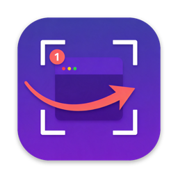
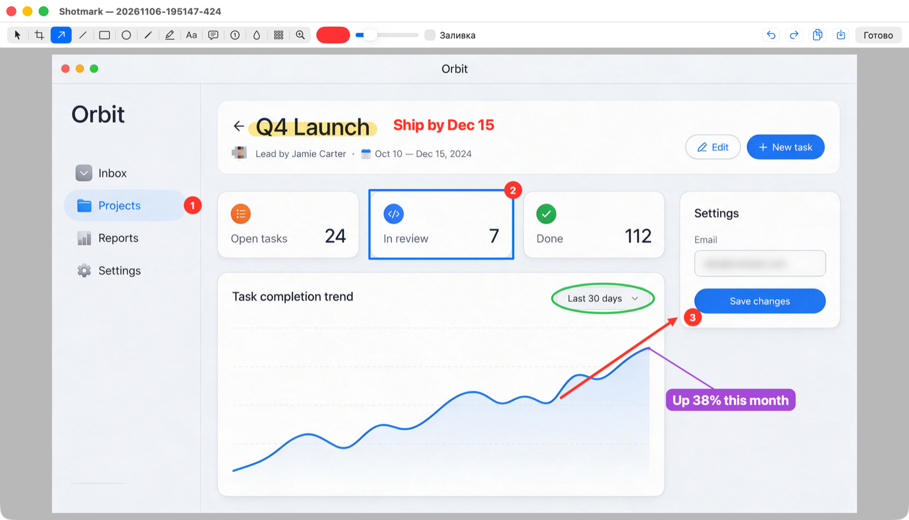
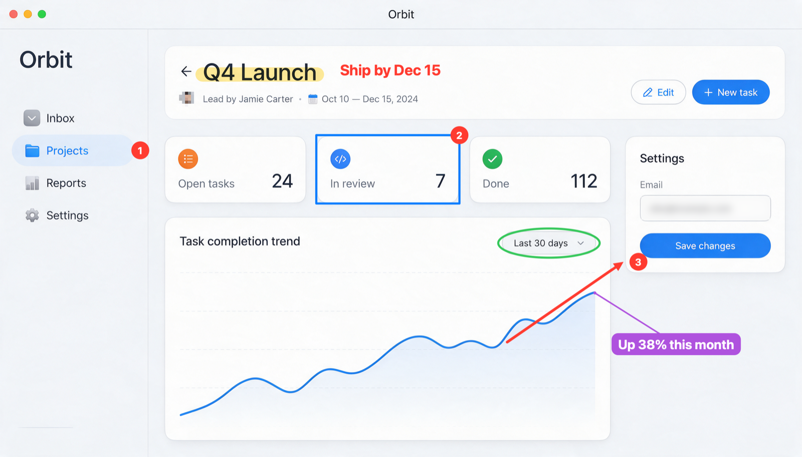

<p align="center">
  
</p>

<h1 align="center">Shotmark</h1>

<p align="center">
  Скриншоты с разметкой для macOS в духе ShareX и MCP-сервер, через который агенты пользуются всеми функциями.
  <br>
  <a href="README.md">English</a>
</p>

<p align="center">
  
</p>

## Что умеет

- Заменяет ⌘⇧3, ⌘⇧4 и ⌘⇧5. Весь экран, область, окно, запись экрана.
- Разметка в момент снимка. По ⌘⇧4 экран замирает и становится холстом. Рисуешь на нём стрелки, шаги, текст, потом тянешь нужную область. Отпустил кнопку мыши, и снимок готов, как в ShareX.
- Инструменты ShareX. Стрелки, линии, прямоугольники, эллипсы, перо, маркер, текст, выноски, нумерованные шаги, размытие, пикселизация, лупа, обрезка, отмена и повтор, цвет и толщина.
- Правка нарисованного. Инструмент «Выбор» двигает фигуры и меняет их размер за маркеры. Правая кнопка по фигуре открывает меню: цвет, толщина, размер, сила размытия, текст.
- Вложенные снимки. ⌘⇧4 внутри снимка снимает экран вместе с ним и открывает следующий уровень. Закончил верхний уровень, вернулся на предыдущий.
- Снимки сохраняются сами. В буфер обмена и в `~/Pictures/Screenshots/ГГГГ-ММ/`.
- MCP-сервер для агентов. 18 инструментов: снимок экрана, области, окна или приложения, список окон, любая разметка, экспорт, история, снимок как изображение. Агент работает в фоне: из-за него у тебя ничего не открывается.

<p align="center">
  
</p>

## Установка

Нужны macOS 15 или новее и инструменты Swift (`xcode-select --install`). Сам Xcode не нужен.

```bash
curl -fsSL https://raw.githubusercontent.com/IliaOknesavi/shotmark/main/scripts/install.sh | bash
```

Скрипт клонирует репозиторий в `~/shotmark`, собирает приложение, подписывает его локальным сертификатом, ставит в `~/Applications/Shotmark.app` и запускает. Если установлен Claude Code, подключает к нему MCP-сервер для всех проектов. Повторный запуск обновляет приложение.

Дальше один раз:

1. Системные настройки → Конфиденциальность и безопасность → Запись экрана и системного звука: включить Shotmark, затем выйти из него через его меню и открыть снова.
2. Когда Shotmark спросит, отдать ему ⌘⇧3 / ⌘⇧4 / ⌘⇧5 вместо стандартных скриншотов. Вернуть их можно в том же меню.

Shotmark запускается при входе в систему и живёт в строке меню. Если строка меню переполнена и значка не видно, открой Shotmark ещё раз через Spotlight: меню появится у курсора.

## Как дать доступ своему агенту

Проще всего отправить агенту ссылку на этот репозиторий и попросить установить Shotmark. Агенту нужно:

1. Запустить `scripts/install.sh` из клона или строку с `curl` выше.
2. Попросить тебя выдать разрешение на запись экрана (шаг 1 выше): сам агент этого сделать не может.
3. Проверить связь: вызвать инструмент `history`, а после выдачи разрешения `capture_screen`.

Для ручного подключения: сервер работает внутри приложения по адресу `http://127.0.0.1:47830/mcp` (Streamable HTTP). Он слушает только localhost, требует токен и отклоняет запросы с веб-страниц. Токен лежит в `~/Library/Application Support/Shotmark/token`, а пункт меню «Скопировать команду подключения MCP» копирует готовую команду для Claude Code.

Claude Code, во всех проектах и чатах:

```bash
claude mcp add --scope user --transport http shotmark http://127.0.0.1:47830/mcp \
  --header "Authorization: Bearer $(cat ~/Library/Application\ Support/Shotmark/token)"
```

Codex:

```bash
echo 'export SHOTMARK_TOKEN="$(cat ~/Library/Application\ Support/Shotmark/token)"' >> ~/.zshenv
codex mcp add shotmark --url http://127.0.0.1:47830/mcp --bearer-token-env-var SHOTMARK_TOKEN
```

Другие клиенты с поддержкой Streamable HTTP и заголовков, например Cursor:

```json
{
  "mcpServers": {
    "shotmark": {
      "url": "http://127.0.0.1:47830/mcp",
      "headers": { "Authorization": "Bearer <токен>" }
    }
  }
}
```

Твою разметку агент тоже видит. Снимаешь по ⌘⇧4, рисуешь, потом просишь агента посмотреть: `get_image` и `get_annotations` без id отдают последний снимок.

## Сочетания

| Клавиши | Действие |
|---|---|
| ⌘⇧3 | Снимок монитора под курсором |
| ⌘⇧4 | Экран замирает: рисуешь, тянешь область, отпускаешь кнопку, снимок готов. Клик по окну снимает окно. Правая кнопка во время протягивания сбрасывает область, правая кнопка по пустому месту или Esc закрывает. ⌘E открывает снимок в редакторе |
| ⌘⇧5 | Запись области или окна в MP4 (`~/Movies/Shotmark`), повторное нажатие останавливает |

Клавиши инструментов: выбор V, область C, стрелка A, линия L, прямоугольник R, эллипс E, перо P, маркер M, текст T, выноска O, шаг N, размытие B, пикселизация X, лупа Z. Shift даёт ровные углы и квадраты, Delete удаляет выделенную фигуру, двойной клик правит текст.

## Инструменты MCP

| Инструмент | Что делает |
|---|---|
| `list_displays`, `list_windows` | Мониторы; окна с id, приложением, заголовком и рамкой |
| `capture_screen`, `capture_area`, `capture_window`, `capture_app` | Снимок монитора, прямоугольника в точках, окна (по id, заголовку или приложению), всех окон приложения |
| `open_image` | Картинка из файла как новый снимок для разметки |
| `annotate` | Пакет аннотаций: arrow, line, rect, ellipse, pen, marker, text, callout, step, blur, pixelate, loupe |
| `get_annotations`, `remove_annotations`, `undo`, `redo`, `crop` | Прочитать и изменить разметку, в том числе нарисованную человеком |
| `export` | PNG или JPEG в файл и (или) в буфер обмена |
| `history`, `get_image` | Список снимков; снимок как изображение |
| `start_recording`, `stop_recording` | Запись экрана или области в MP4 |

Координаты захвата задаются в точках экрана, от левого верхнего угла главного монитора. Координаты аннотаций задаются в пикселях снимка, на Retina их вдвое больше, чем точек. Картинка в ответе уменьшается до 1568 px, множитель для пересчёта указан в тексте ответа.

## Сборка из исходников

```bash
scripts/make-cert.sh   # самоподписанный сертификат «Shotmark Dev», чтобы разрешение переживало пересборки
scripts/build.sh       # сборка SwiftPM в ~/Applications/Shotmark.app
```

Около 2200 строк Swift без зависимостей: ScreenCaptureKit для снимков и записи, AppKit для интерфейса, сочетания через Carbon (разрешение «Универсальный доступ» не нужно), Network.framework для MCP-сервера. Снимки с редактируемой разметкой хранятся в `~/Library/Application Support/Shotmark/shots/`.

## Ограничения

- Интерфейс только на русском.
- Область на стыке двух мониторов обрезается по монитору, где её центр.
- Без локального сертификата приложение подписывается ad hoc, и macOS заново спрашивает разрешение на запись экрана после каждой сборки.

## Лицензия

[MIT](LICENSE)
